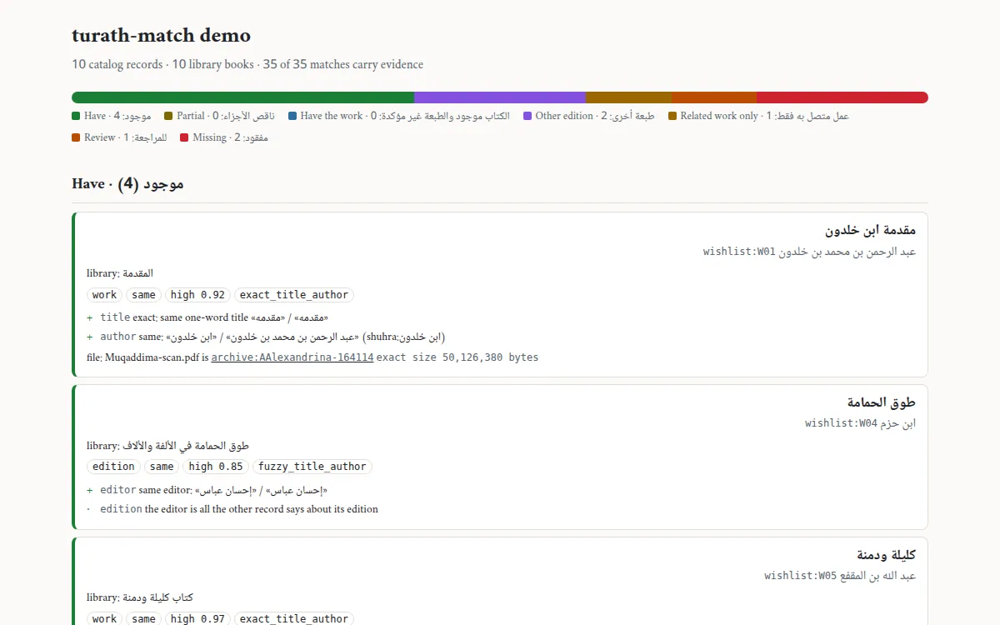
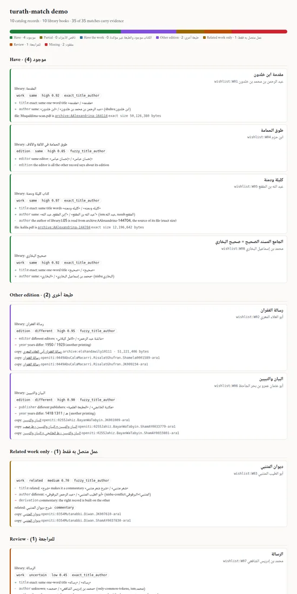
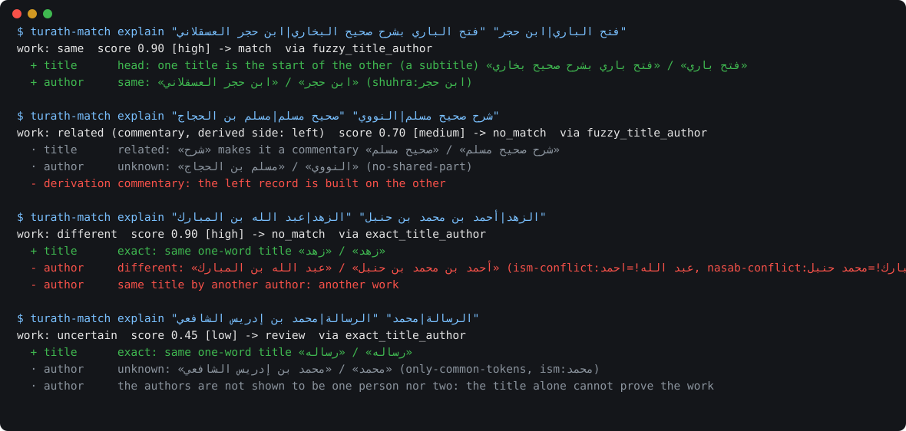
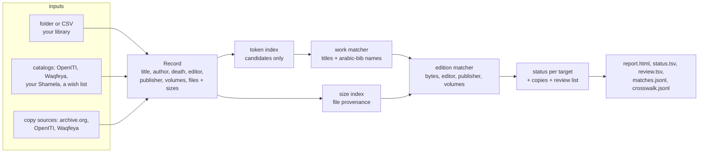
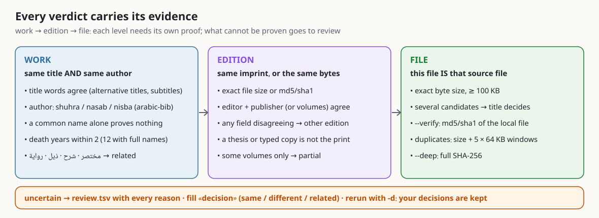

# turath-match

**Which of these Arabic heritage works and editions do I already have, which are missing, and where is a
trustworthy copy? Every answer comes with its evidence.**

[](https://github.com/kmbenjel/turath-match/actions/workflows/ci.yml)
[](https://pypi.org/project/turath-match/)
[](https://pypi.org/project/turath-match/)
[](LICENSE)
[](https://warraq.benjelloun.dev/turath-match/)



```bash
uvx turath-match demo --open        # a 10-book library, a 10-work wish list, real archive.org and OpenITI records
turath-match reconcile -l folder:~/Books -t csv:wishlist.csv -c archive:items.jsonl -o out
turath-match explain "فتح الباري|ابن حجر" "فتح الباري بشرح صحيح البخاري|ابن حجر العسقلاني"
```

turath-match reconciles a collector's library (a folder of PDFs or a CSV) with the catalogs of Arabic heritage
books (OpenITI, archive.org, Waqfeya, your own Shamela install, any CSV) at three levels: the **work**, the
**edition**, and the **file**, byte for byte. It does not guess: a match the evidence cannot settle goes to a review
list, and your decisions on it are kept.

## Why turath-match? How it compares

Measured on public data: the 12,688 Arabic text versions of OpenITI 2025.1.9 that carry a title and an author, whose book URIs (curated by
the KITAB project) say which versions are one work. The matcher never sees the URIs. The matching rules were
developed on this same OpenITI release, so the table below is the development set; the held-out result follows it.
Every number comes from [`bench/compare.sh`](bench/compare.sh), run on a 32-vCPU server on 2026-11-13.

| Same-work pairs among 12,688 OpenITI versions (7,254 true pairs) | Precision | Recall | Reason given per decision |
|---|---:|---:|---|
| **turath-match 0.1** | **0.984** | **0.812** (+ 332 more on the review list) | ✓ every one |
| OpenRefine 3.10.1, fingerprint clustering, title + author | 0.741 | 0.439 | ✗ |
| OpenRefine 3.10.1, nearest-neighbour Levenshtein (radius 2), title | 0.619 | 0.578 | ✗ |
| OpenRefine 3.10.1, fingerprint clustering, title only | 0.648 | 0.559 | ✗ |
| Baseline: identical title, no clustering | 0.648 | 0.556 | ✗ |

Fingerprint clustering on the title adds 16 true pairs and 4 wrong ones to the identical-title baseline (4,052 and
2,196 against 4,036 and 2,192).

**Held out.** With one side the rules never saw, 657 Wikidata book items (the Arabic title and author labels written
by Wikidata's editors) against the same 12,688 OpenITI versions, labelled by the Shamela book id that both carry
(Wikidata P12239, and the `Shamela…` part of an OpenITI version URI), turath-match reaches **0.980 precision and
0.727 recall**; without the version made from that very Shamela book, 0.969 and 0.699
([`bench/wikidata_heldout.py`](bench/wikidata_heldout.py)).

| Checked 2026-11-13 | turath-match | Searching Shamela / Waqfeya / archive.org by hand | OpenRefine 3.10.1 | Calibre (metadata download, Find Duplicates plugin) | OpenITI / KITAB tools |
|---|---|---|---|---|---|
| Arabic name sense (kunya, nasab, nisba, shuhra; «ابن» = «بن») | ✓ | by eye | ✗ (keyers built for Latin script) | ✗ | curated URIs, not a matcher for your files |
| A commentary, abridgement or other recension is not the work | ✓ | by eye | ✗ | ✗ | ✓ in its own relations file |
| Edition matching (editor, publisher, volumes) | ✓ | by eye | ✗ | ✗ | ✗ |
| Byte-exact provenance of your files (sizes, md5/sha1) | ✓ | ✗ | ✗ | binary compare inside one library | ✗ |
| Duplicate proof without reading whole files | ✓ (5 × 64 KB) | ✗ | ✗ | full binary compare | ✗ |
| A reason and a confidence on every decision; a review list kept across runs | ✓ | in your head | clusters, no reasons | ✗ | ✗ |
| Works on your own folder of PDFs, offline | ✓ | ✗ | through a CSV export | ✓ | ✗ |
| Where a missing work can be downloaded, with exact sizes | ✓ | ✓ (slowly) | ✗ | metadata only | texts only |

OpenRefine's clustering and Calibre's duplicate check were read from their current documentation (OpenRefine
«Clustering in depth», the Find Duplicates plugin wiki); OpenRefine was also run on the benchmark above through its
own HTTP API ([`bench/openrefine_compare.py`](bench/openrefine_compare.py)).

**What makes the difference, with evidence:**

1. **Precision first.** 98.4 % of the pairs turath-match calls «the same work» are the same OpenITI work
   (98.0 % on the held-out Wikidata records); OpenRefine's best clustering of the same records reaches 74.1 %. Common names never carry a match, and
   «شرح», «مختصر», «ذيل», «رواية» make a *related* work, never the work ([the rules](docs/matching.md)).
2. **Editions, not only works.** Against the Shamela books OpenITI texts were made from (run on your own install
   with [`bench/shamela_openiti.py`](bench/shamela_openiti.py)), 99.3 % of «same edition» verdicts are right.
3. **Bytes beat names.** A file called `Muqaddima-scan.pdf` is the Bibliotheca Alexandrina's 1886 print because
   its size is 50,126,380 bytes; a file with no author takes its author from the record of the scan it is
   (`turath-match demo` shows both).
4. **Every decision explains itself.** 100 % of the 300,155 decisions made in these benchmarks carry
   their evidence, and `turath-match explain` prints it for any pair.
5. **Minutes, not days.** A 500-book library against the whole OpenITI catalog (8,233 works) takes
   154 s: 376 books found with 99.5 % precision, 80 items left for a person. Checked by hand
   at an assumed 3 minutes a book, the same library is 25 hours of work.

**When to use something else.** To clean a general spreadsheet or reconcile names against Wikidata, use OpenRefine.
To manage e-books on a reader, use Calibre. To study text reuse between works (which passages one author took from
another), use the KITAB project's passim data. turath-match does one thing: tell an Arabic collector what they hold,
at work, edition and file level, and prove it.

## What it answers

| Status | Meaning |
|---|---|
| `have` | the work is in the library and the edition is proven (exact size or checksum, or editor and publisher), or no edition was asked for |
| `partial` | the same edition, with some of its volumes |
| `have_work` | the work is there; nothing says which edition |
| `other_edition` | the work is there in another edition (an editor, publisher or volume count disagrees) |
| `related_only` | only a commentary, abridgement, selection or continuation of it |
| `review` | a possible match the evidence cannot settle: fill in `review.tsv` and pass it back with `-d` |
| `missing` | not in the library, with trustworthy copies (archive.org files with exact sizes, OpenITI texts) |




<br clear="right">

## Features

- **Three levels.** Work (title + author), edition (exact bytes, or editor + publisher + volumes), file (exact
  byte size, optional md5/sha1).
- **Arabic bibliographic sense**, through [arabic-bib](https://github.com/kmbenjel/arabic-bib): kunya, nasab,
  nisba, laqab and shuhra; library-catalog order («ابن المقفع، عبد الله»); death years with tolerance; alternative
  titles («=», «المسمى»), subtitles, edition tails («- ت …», «- ط …»), works printed together («ويليه»).
- **Sources:** a folder (naming profiles), CSV/TSV (English or Arabic headers), [OpenITI](https://openiti.org)
  release metadata, archive.org (`advancedsearch` and `_files.xml`), Waqfeya (public list API and book pages), your
  own Shamela install (read-only, [legal note](docs/shamela.md)), JSONL ([all sources](docs/sources.md)).
- **Polite on the network:** a disk cache, one request per second per host, retries with back-off, `--offline`,
  and a User-Agent that names the tool.
- **Duplicates proven** by size and five 64 KB windows (works over FTP or SFTP), optional full SHA-256, and a
  [planfs](https://github.com/kmbenjel/planfs) plan that quarantines the copies and keeps the best-named one (a
  name the naming profile reads beats `scan_0007.pdf`; then more name parts; then the shorter path).
- **Outputs for people and machines:** `report.html`, `report.md`, `status.tsv`, `review.tsv`, `copies.tsv`,
  `matches.jsonl` and a work `crosswalk.jsonl` ([schema](docs/schema.md)) that
  [turath-catalog](https://github.com/kmbenjel/turath-catalog) imports.
- **Small:** standard library plus arabic-bib; Python 3.10 to 3.13; every command's `--help` ends with an example.

## Architecture





## Usage

```bash
# your library: a folder («title - author - ت editor - ط publisher.pdf», numbered volumes in a folder) or a CSV
turath-match scan ~/Books -o library.jsonl

# catalogs, fetched politely and cached
turath-match fetch openiti -o openiti.tsv
turath-match fetch archive --search "طوق الحمامة|ابن حزم" -o items.jsonl
turath-match fetch waqfeya --max-pages 5 --details -o waqfeya.jsonl

# which works on my wish list do I have, and where are the missing ones?
turath-match reconcile -l jsonl:library.jsonl -t csv:wishlist.csv -c archive:items.jsonl -c openiti:openiti.tsv -o out

# which Shamela books do I have as scans? (your own install, read-only)
turath-match reconcile -l folder:~/Books -t shamela:~/.local/share/shamela -o out

# file provenance and duplicates
turath-match provenance -l folder:~/Books -s archive:items.jsonl --verify -o provenance.tsv
turath-match dups ~/Books --deep --plan dedupe.tsv
```

From Python:

```python
from turath_match import Record, match_work

m = match_work(Record("a", "1", "مختصر صحيح مسلم", "المنذري"), Record("b", "2", "صحيح مسلم", "مسلم بن الحجاج"))
m.verdict, m.relation, m.status          # ('related', 'abridgement', 'no_match')
print(m.explain())
```

## Benchmarks

| Benchmark ([`bench/compare.sh`](bench/compare.sh), 2026-11-13) | Size | Precision | Recall | Time (12 workers) |
|---|---:|---:|---:|---:|
| Work level: OpenITI versions against each other (the development set) | 12,688 versions, 237,811 pairs compared | 0.984 | 0.812 | 271 s |
| Work level, held out: Wikidata records against OpenITI | 657 items × 12,688 versions, 20,715 pairs | 0.980 | 0.727 | 9 s |
| Work level: OpenITI against the Shamela books they were made from | 3,566 × 3,557 | 0.996 | 0.716 | 53 s |
| Edition level: the same pairs | 2,853 same-work pairs | 0.993 | 0.498 | |
| A 500-book library against the OpenITI catalog | 500 × 8,233 | 0.995 | 0.752 | 154 s (1 process) |

The rules were developed on OpenITI 2025.1.9, which every row draws on; the held-out row sets Wikidata's records,
which the rules never saw, against it. Method, every table and the kinds of error:
[docs/benchmarks.md](docs/benchmarks.md). Recall counts every pair OpenITI files under one book URI, including volumes split into separate texts, hadith
*juz'* collections filed under their compiler, and titles that share no word at all (*al-Wajīz* and *Tafsīr
al-Wāḥidī*). Edition recall is low by design: about half of the records name no editor and no publisher, and those
pairs are reported as `have_work` («edition not proven») instead of being guessed.

## Design decisions

- **A wrong «same» costs more than a «review».** Thresholds are set for precision; everything else is shown with
  its reasons.
- **Names come from arabic-bib**, shared with the rest of the [Warraq](https://warraq.benjelloun.dev) family, so the
  keys a catalog is built with and the keys a match is made with are the same (`cluster_id` is turath-catalog's
  `work_id`).
- **Bytes before labels.** Labels on upload sites can be wrong, and one archive.org item often holds several books,
  so exact sizes are counted per file, never per item.
- **Catalogs are read, not bundled.** Adapters read what you fetch or already have; tests use small hand-made
  fixtures; Shamela is read from your own install only. The one exception is the small demo set listed under
  [Licence and data](#licence-and-data).
- **Rules you can read.** The matcher is a few hundred lines of explicit rules ([docs/matching.md](docs/matching.md)),
  not a trained model: every verdict traces back to a line of evidence.

## Roadmap

- A Wikidata adapter (QIDs for works and authors), and VIAF for modern editors.
- Title-page reading (OCR of the first pages) as edition evidence for files with no metadata.
- A static web demo (Pyodide) that reconciles a CSV in the browser.
- More copy sources: the Qatar Digital Library, HathiTrust public-domain scans.

## Contributing

See [CONTRIBUTING.md](CONTRIBUTING.md). The most useful bug report is a pair of records turath-match got wrong:
`turath-match explain "title|author" "title|author"` prints what it saw.

## Licence and data

Code: MIT. The package (and the repository) carries one data set, the demo in
[`src/turath_match/demo/`](src/turath_match/demo/README.md):

| File | What it is | Licence |
|---|---|---|
| `library.csv`, `wishlist.csv` | a made-up 10-book library and a 10-work wish list | MIT, with the code |
| `archive.jsonl` | 11 archive.org items: identifiers, titles, file names, sizes, checksums (metadata only, no books) | metadata of public items, recorded with `turath-match fetch archive` |
| `openiti.tsv` | 27 rows of the OpenITI release 2025.1.9 metadata (selected columns) | CC BY-NC-SA 4.0, cited: Nigst, Romanov, Savant, Seydi, Verkinderen et al., [doi:10.5281/zenodo.17767721](https://doi.org/10.5281/zenodo.17767721) |

The OpenITI rows keep their own licence, which is non-commercial and share-alike: they are not MIT, and they
are why [turath-catalog](https://github.com/kmbenjel/turath-catalog), whose data are CC BY 4.0, links to OpenITI by
identifier only. [`examples/demo-report/`](examples/demo-report/) is the demo's output, and
[`bench/results/`](bench/results/) holds the benchmark counts with a few example pairs quoted from the OpenITI
metadata. turath-match ships no Shamela or Waqfeya data. To cite: [CITATION.cff](CITATION.cff).
