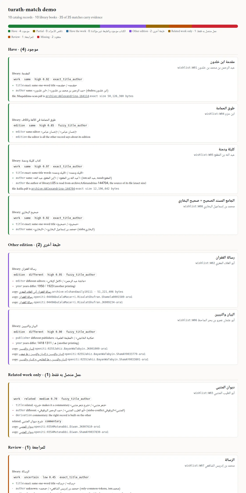

# turath-match: مطابقة التراث

كل من جمع مكتبة من كتب التراث يسأل في يوم ما: **أيّ هذه الكتب والطبعات عندي؟ وأيها ينقصني؟ وأين أجد نسخة
موثوقة مما ينقصني؟** والجواب اليدوي طويل: تبحث عن الكتاب في الشاملة، ثم في الوقفية، ثم في أرشيف الإنترنت، وتقارن
العنوان والمؤلف والمحقق والناشر وعدد الأجزاء، كتابًا كتابًا.

تقوم turath-match بهذا العمل عنك. تعطيها مكتبتك (مجلدًا من ملفات PDF أو جدولًا CSV) وقائمة ما تبحث عنه أو فهرسًا
كاملًا، فتعيد إليك لكل كتاب حكمًا من سبعة:

| الحكم | معناه |
|---|---|
| موجود | الكتاب عندك، والطبعة ثابتة بحجم الملف أو بالمحقق والناشر |
| ناقص الأجزاء | الطبعة نفسها، وبعض أجزائها فقط |
| الكتاب موجود والطبعة غير مؤكدة | لا يذكر أحد الطرفين ما يكفي لمعرفة الطبعة |
| طبعة أخرى | الكتاب عندك بطبعة غير المطلوبة |
| عمل متصل به فقط | عندك شرحه أو مختصره أو ذيله، لا الكتاب نفسه |
| للمراجعة | احتمال لا يكفي الدليل لحسمه، فيُعرض عليك |
| مفقود | ليس عندك، ومعه النسخ الموثوقة التي وُجدت له |

## ما الذي يميزها؟

- **لكل حكم دليله.** لا تقول الأداة «موجود» فحسب، بل تقول لماذا: العنوانان متفقان، والمؤلف واحد لأن شهرته
  «ابن حجر» في الطرفين، وحجم الملف يساوي حجم ملف أرشيف الإنترنت بالبايت.
- **لا تخمّن.** الاسم الشائع وحده («محمد»، «الدمشقي»، «شمس الدين») لا يثبت شيئًا، والمختصر والشرح والذيل
  والرواية الأخرى ليست الكتاب نفسه. وما لا يحسمه الدليل يذهب إلى قائمة المراجعة.
- **الطبعة غير الكتاب.** لا يكفي العنوان والمؤلف لإثبات الطبعة: لا بد من اتفاق المحقق والناشر وعدد الأجزاء، أو
  تطابق حجم الملف.
- **مصادر مفتوحة وأخرى عندك.** فهارس OpenITI وأرشيف الإنترنت والوقفية، وفهرس نسختك من الشاملة على جهازك، وأي
  جدول تكتبه بنفسك.

ابدأ من [البدء السريع](quickstart.md)، واقرأ [ما الذي يميّزه؟](why.md) للمقارنة بالبدائل وبالأرقام.
