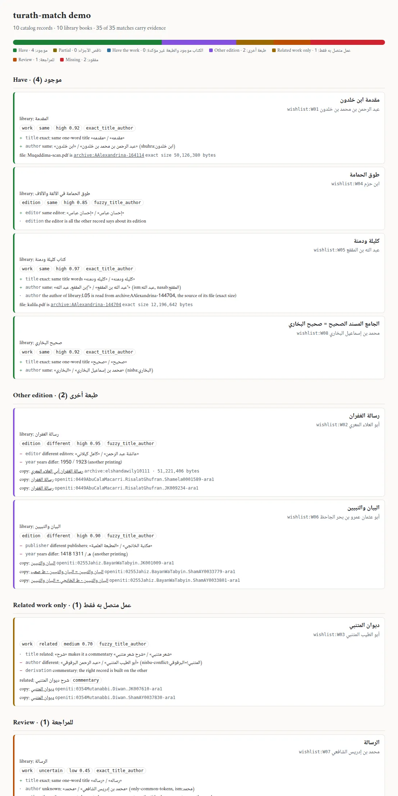

# ما الذي يميّزه؟

## الطريقة المعتادة وما فيها من عناء

يبحث جامع الكتب عادة عن كل كتاب على حدة: في الشاملة، ثم في الوقفية، ثم في أرشيف الإنترنت، ثم يقارن بنفسه العنوان
والمؤلف والمحقق والناشر. وإذا قدّرنا ثلاث دقائق لكل كتاب، فمكتبة من خمسمئة كتاب تحتاج إلى نحو 25 ساعة
من العمل، مع ما في التعب من خطأ.

## المقارنة بالأدوات الأخرى

| | turath-match | البحث اليدوي | OpenRefine 3.10.1 | Calibre | أدوات OpenITI وKITAB |
|---|---|---|---|---|---|
| فهم الأسماء العربية (الكنية والنسب والنسبة والشهرة) | نعم | بالعين | لا، طرق التجميع فيه مصممة للحرف اللاتيني | لا | معرّفات محررة يدويًّا، لا أداة لملفاتك |
| التمييز بين الكتاب وشرحه ومختصره وروايته | نعم | بالعين | لا | لا | في ملف العلاقات الخاص بها |
| مطابقة الطبعة (المحقق والناشر وعدد الأجزاء) | نعم | بالعين | لا | لا | لا |
| معرفة أصل الملف بحجمه بالبايت وبصمته | نعم | لا | لا | مقارنة ثنائية داخل المكتبة الواحدة | لا |
| دليل ودرجة ثقة مع كل حكم، وقائمة مراجعة محفوظة | نعم | في ذهنك | مجموعات بلا أسباب | لا | لا |
| مكان النسخة الموثوقة لما ينقص، مع حجمها | نعم | نعم، ببطء | لا | بيانات وصفية فقط | النصوص فقط |

## الأرقام

اختبرنا الأداة على بيانات عامة يمكن لأي أحد أن يعيد التجربة عليها: نسخ النصوص العربية في إصدار OpenITI
2025.1.9، وعددها 12,688 نسخة. يجمع فريق KITAB النسخ التي هي كتاب واحد تحت معرّف واحد، فهذا هو «الجواب
الصحيح»، ولا ترى الأداة هذه المعرفات أثناء المطابقة. وننبّه إلى أن قواعد المطابقة طُوّرت على هذا الإصدار نفسه من
OpenITI، فأرقام هذا الجدول أرقام مجموعة التطوير، وبعده نتيجة الاختبار على بيانات لم تُستعمل في التطوير.

| الطريقة | الدقة (من الأزواج التي قيل إنها كتاب واحد، كم هي كذلك فعلًا) | الاستدعاء (من الأزواج الصحيحة، كم وُجد) |
|---|---:|---:|
| **turath-match** | **98.4 %** | **83.4 %**، وفي قائمة المراجعة 345 زوجًا صحيحًا آخر |
| OpenRefine، التجميع بالبصمة على العنوان والمؤلف | 74.1 % | 43.9 % |
| OpenRefine، أقرب الجيران (ليفنشتاين) على العنوان | 61.9 % | 57.9 % |
| خط الأساس: تطابق العنوان حرفًا بحرف، بلا تجميع | 64.8 % | 55.6 % |

وخط الأساس هذا يبيّن ما يضيفه التجميع: التجميع بالبصمة على العنوان في OpenRefine لا يزيد عليه إلا 17 زوجًا صحيحًا
(و4 أزواج خاطئة).

**اختبار على بيانات لم تُستعمل في التطوير.** أخذنا من ويكي بيانات 657 كتابًا لها معرّف كتاب في الشاملة، بعناوينها
وأسماء مؤلفيها كما كتبها محرّرو ويكي بيانات (وكثيرًا ما يضيفون الناشر والسنة بين قوسين)، وطابقناها بنسخ OpenITI
نفسها. والجواب الصحيح يُعرف آليًّا من معرّف الشاملة الذي يحمله الطرفان: فنسخة OpenITI المأخوذة من كتاب في الشاملة
تحمل رقمه في معرّفها. فكانت الدقة 98.1 % والاستدعاء 75.5 %، وإذا استبعدنا النسخة المأخوذة من كتاب الشاملة نفسه
فالدقة 97.1 % والاستدعاء 72.8 %.

وعلى مستوى الطبعة، قارنّا نصوص OpenITI بكتب الشاملة التي أُخذت منها (على نسخة محلية من الشاملة): كان
99.3 % من أحكام «الطبعة نفسها» صحيحًا.

وفي تجربة مكتبة من خمسمئة كتاب مقابل فهرس OpenITI كله (8,233 كتابًا): انتهت المطابقة في 37
ثانية، ووُجد 380 كتابًا بدقة 99.5 %، وبقي 82 عنصرًا للمراجعة البشرية.

وكل حكم من الأحكام التي صدرت في هذه التجارب (329,904 حكمًا) يحمل دليله، أي 100 %.

## مثال من التقرير

## متى تختار أداة أخرى؟

- لتنظيف جدول عام أو مطابقة أسماء بقاعدة ويكي بيانات: OpenRefine.
- لإدارة كتب إلكترونية على قارئ: Calibre.
- لدراسة النقل بين النصوص (أي فقرة أخذها مؤلف من آخر): بيانات passim من مشروع KITAB.

أما turath-match فلها عمل واحد: أن تقول لجامع كتب التراث ما عنده على مستوى الكتاب والطبعة والملف، وأن تثبت ذلك.
