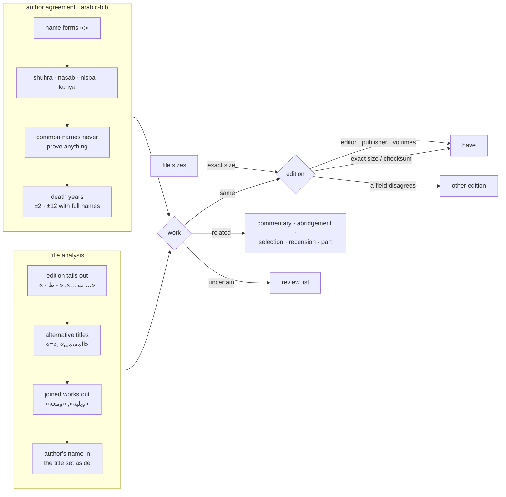

# How matching works

turath-match decides at three levels and keeps every reason. The code is small and the rules are explicit, so a
wrong verdict can be traced to one line of evidence.

## 1. Work

Two records name the same work when **the titles agree and the authors agree**.

**Candidates.** Records are compared only when they are worth it: they share the first word of a title, or two
title words, or one title word and a distinctive word of the author's name. The last rule is what finds «تاريخ
الإسلام» for «تاريخ الإسلام ووفيات المشاهير والأعلام» by al-Dhahabī, whose short title is made of words half the
catalog holds.

**Titles.** A title is taken apart before it is compared: edition tails (« - ت محب الدين الخطيب», « - ط السلفية»,
« - دار النفائس», and the same written with no dash: «البعث والنشور للبيهقي ت الشوامي», «التبيان ط عالم الفوائد»)
become editor and publisher hints; what a digital library says about its own copy («موافق للمطبوع», «مشكول»,
«نسخة أخرى», an alternative «= مقابل») is dropped; alternative titles («الجامع الصحيح = صحيح البخاري», «تفسير القشيري المسمى
لطائف الإشارات») are compared one by one; works printed with it («ويليه …», «ومعه …», «وبهامشه …») are set aside;
function words, the article and joined particles (و ب ل ف) never make two words differ; «ابن» = «بن», «ديوان» =
«شعر»; a leading «كتاب», «مسألة» or «جزء فيه» is dropped; the author's own name inside a title («مقدمة ابن
خلدون», «شعب الإيمان للبيهقي») is set aside and, when the other record lacks an author, counts as author evidence.

Then the two titles are:

| Kind | Rule | Score |
|---|---|---|
| exact | the same words | 1.0 (0.9 for a one-word title) |
| head | one title is the start of the other (a subtitle), or holds every word of a shorter title of 3+ words that starts alike | 0.85 (0.7 when a size word «الكبرى» is on one side only; 0.55 for a one-word title) |
| fuzzy | 3+ words each, same first word, at most one word in four differs | 0.7 |
| related | the longer title adds a word that makes another work: «مختصر», «شرح», «حاشية», «ذيل», «تكملة», «منتقى», «زوائد», «نظم», «رد», «تخريج», «فهارس», «دراسة», «ترتيب»… | — |
| conflict | different size words («السنن الكبرى» / «الصغرى»), or a different recension or part («رواية يحيى» / «رواية أبي مصعب», «السفر الثاني») | — |
| none | anything else; two-word titles must be equal | — |

**Authors** come from [arabic-bib](https://github.com/kmbenjel/arabic-bib): a name is parsed into ism, kunya, nasab,
nisba, laqab and shuhra, and two names are `same`, `different` or `unknown`. A match never rests on a common name
alone: «محمد», «أحمد», «عبد الله», «شمس الدين», «الدمشقي», «الشافعي» prove nothing by themselves. The old and
regional spellings of a name meet («إسحق» = «إسحاق», «عبد الرحمان» = «عبد الرحمن»), the asides of a long catalog
form («ويقال: …», «بالولاء») are set aside, and a man named after a relative is another author: «سبط ابن الجوزي»
never matches «ابن الجوزي». turath-match adds
the catalog layer on top: every pair of name forms a catalog gives («الجاحظ ؛ أبو عثمان عمرو بن بحر») is tried and
one proving form is enough; library-catalog order («ابن المقفع، عبد الله») is turned around; death years agree
within 2 years, and up to 12 years apart only when the full names agree (catalogs give 356 or 362 for Abū
al-Faraj al-Iṣfahānī), with a penalty in the score; a shared common name plus the same death year is one man.

| Titles | Authors same | Authors different | Author unknown |
|---|---|---|---|
| exact | **same** 0.97 | different (same title, another work: «الزهد» of Ibn Ḥanbal vs Ibn al-Mubārak) | uncertain 0.7 → review |
| head | **same** 0.9 | different | uncertain → review |
| fuzzy | same 0.78 → review | different | uncertain → review |
| related | related (the commentary, abridgement … is not the work) | related | related |

A collection title by an author («رسائل الجاحظ», «الرسائل الأدبية») never matches a single work on its own: many
single epistles carry it.

## 2. Edition

Title and author never prove an edition (in the Warraq library this rule came from a check in which title + author
let three wrong books out of eight through: a typed transcription, a thesis about the book, and one part of
another edition).

- **Bytes first.** A file of exactly the record's size (100 KB or more) proves the edition; an equal md5/sha1 proves
  it beyond doubt. Some of the record's volumes present → `partial`.
- **Otherwise the imprint:** the editor (arabic-bib `same_person`), the publisher (arabic-bib `same_publisher`, with
  and without the city: «دار طيبة، الرياض - السعودية» = «دار طيبة - الرياض»), the number of volumes and the year.
  Same edition when the editor and the publisher (or the volumes) agree, or when every field both records give
  agrees and there are at least two. Any disagreeing editor, publisher or volume count makes it **another
  edition**; a different year alone is another printing (a penalty, not a veto).
- A thesis, a manuscript or a typed copy is never the printed edition it is about.
- A wish-list record that names only its editor is satisfied by a copy with that editor.

## 3. File

Every library file is looked up by exact size in every source that publishes sizes (archive.org `_files.xml`,
Shamela's PDF links, your CSVs). One candidate → the file *is* that source file (score 0.95; 0.5 under 100 KB).
Several → the one whose record also matches the title, and whose other files are this book's other volumes;
flagged as ambiguous. `--verify` hashes the local file when the source gives md5/sha1. A library book with no
author takes the author of the record its file came from, and says so in the evidence.

## Duplicates

Two files are duplicates when their sizes are equal and five 64 KB windows agree (start, 25 %, 50 %, 75 %, end):
320 KB read per file, so it works over FTP/SFTP, where checksums are not available. `--deep` adds a full SHA-256.
A file that cannot be read gets its own fingerprint and is never a duplicate. `--plan` writes a
[planfs](https://github.com/kmbenjel/planfs) plan that moves every copy but one to quarantine; nothing is deleted
by turath-match itself. The copy kept is the best-named one: a name the naming profile reads into a title and
another part beats a scanner's name; then the name with no mark of a second copy («- Copy», «(1)», «Copy of …»,
«نسخة ثانية»); then more name parts; then the shorter path.

## The review list

Everything uncertain goes to `review.tsv` with its reasons and an empty `decision` column. Fill in `same`,
`different` or `related`, and pass the file back with `-d review.tsv`: decisions are applied as `manual` matches
and survive every rerun.
